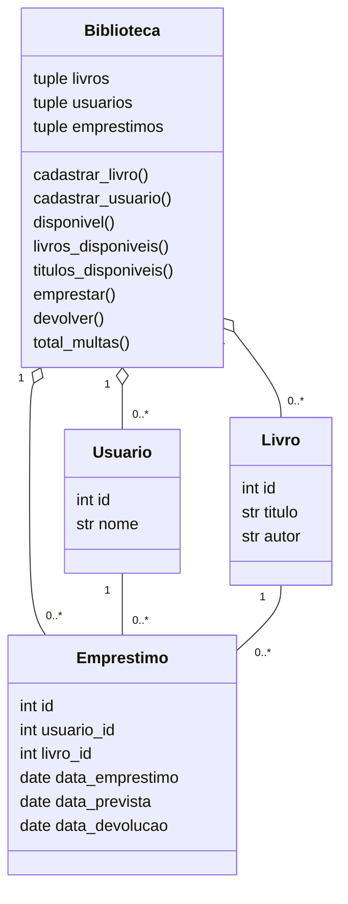
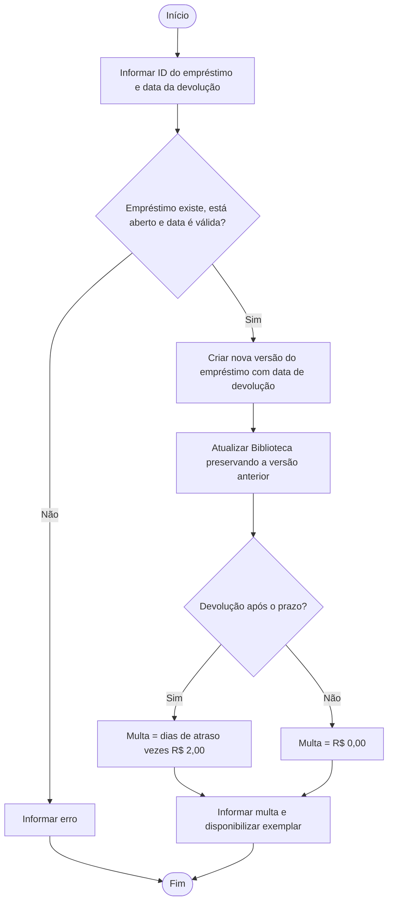

# Material para copiar à mão

Escreva nome, turma, data e integrantes do grupo. Este material é uma sugestão: o enunciado não especifica os tipos dos diagramas nem apresenta as cinco questões. Caso o professor tenha fornecido essas informações, siga as orientações dele.

## 1. Diagrama de classes

Desenhe as classes com seus atributos e métodos conforme abaixo. Os relacionamentos por identificador representam as associações entre empréstimos, usuários e livros.

Cada exemplar pode ter vários empréstimos no histórico, mas apenas um ativo por vez. A data de devolução é opcional e permanece vazia enquanto o empréstimo estiver aberto.

## 2. Diagrama de atividades: devolução

Use elipses para início e fim, retângulos para ações e losangos para decisões.

## 3. Questões e respostas

**1. Como a orientação a objetos é aplicada?**

As classes Livro, Usuario e Emprestimo representam os dados do domínio. A classe Biblioteca reúne os registros e os comportamentos de cadastro, empréstimo, devolução e consulta. Cada classe possui uma responsabilidade definida.

**2. O que são funções puras e onde aparecem?**

Funções puras retornam o mesmo resultado para os mesmos argumentos e não alteram estado externo. A função calcular_multa recebe duas datas e retorna o valor da multa, sem modificar os empréstimos nem consultar o relógio do computador.

**3. Como a imutabilidade é aplicada?**

Os modelos usam dataclasses congeladas e coleções em tuplas. Os métodos retornam uma nova Biblioteca usando replace, preservando os objetos anteriores. Na devolução, também é criada uma nova versão do empréstimo.

**4. Como map, filter e reduce são utilizados?**

Map transforma livros disponíveis em títulos e produz a coleção atualizada após uma devolução. Filter seleciona somente os livros disponíveis. Reduce acumula os valores das multas em um total, começando em zero.

**5. Quais regras são verificadas pelos testes?**

Os testes verificam o bloqueio de um exemplar já emprestado, a liberação após devolução, a preservação dos dados anteriores e a rejeição de referências e datas inválidas. Também verificam a multa: no prazo ela é zero; com três dias de atraso, é R$ 6,00. Após a devolução, a multa para de crescer.

Entregue este conteúdo escrito à mão em papel A4 branco, fisicamente ao professor em sala de aula.
